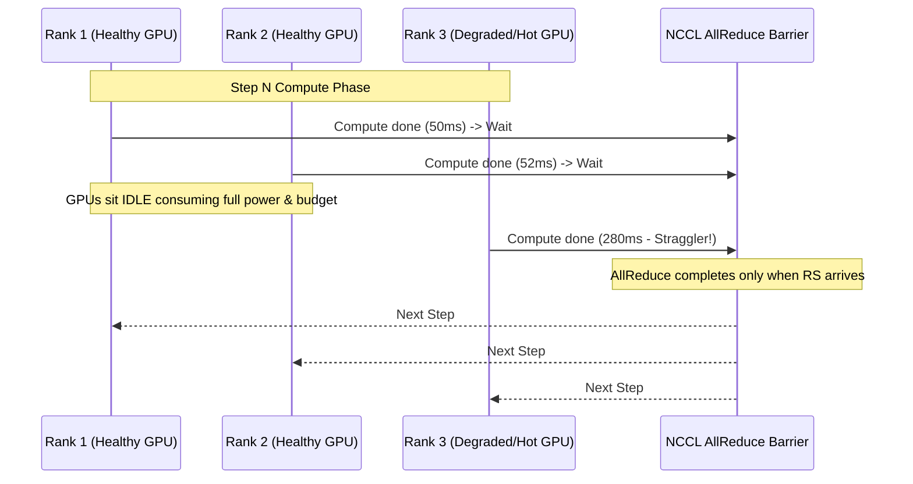
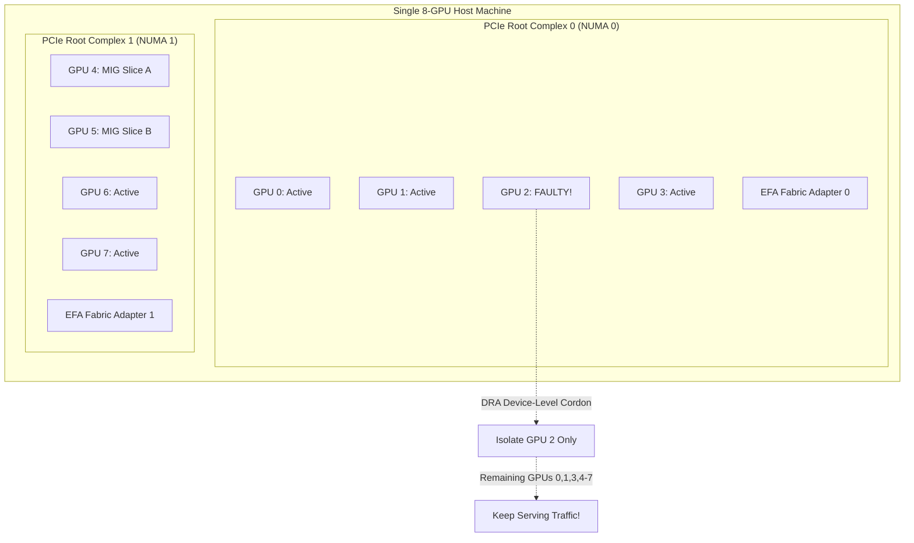

# 41. Reliable GPU Compute for Distributed AI Workloads (Netflix) — Key Takeaways

> **Parent**: [AI/ML Infrastructure](index.md)  
> **Source**: [Reliable GPU Compute for Large Training & Inference Jobs](../../articles/case-studies/netflix-reliable-gpu-compute.md)  
> **Authors**: Nick Rutigliano, Argha C, Samartha Chandrashekar (Netflix Technology Blog, published 2026-10-14)  
> **Purpose**: Extract reusable system design and platform engineering patterns from Netflix's GPU infrastructure architecture — covering gang execution reliability, layered fail-closed health checking, graded automated remediation with Karpenter, pre-flight burn-in validation, failure attribution, and topology-aware hardware allocation.

> **Also see**: [Batch Compute with Kueue](ai-batch-compute-kueue.md) (`ai-04`–`ai-08`), [AI/ML Infrastructure](ai-ml-infrastructure.md) (`ai-01`–`ai-03`), [On-Device MoE Inference](38-ai-key-takeaways.md) (`ai-28`–`ai-30`), [Resilience Patterns](../resilience/resilience-patterns.md) (`resilience-01`–`resilience-05`)  
> **Dictionary**: [Gang Scheduling](../../reference-dictionary/ai-ml-llm.md#gang-scheduling), [Goodput](../../reference-dictionary/ai-ml-llm.md#goodput-ai), [Elastic Fabric Adapter](../../reference-dictionary/ai-ml-llm.md#elastic-fabric-adapter), [Dynamic Resource Allocation (DRA)](../../reference-dictionary/ai-ml-llm.md#dynamic-resource-allocation-dra), [Multi-Instance GPU (MIG)](../../reference-dictionary/ai-ml-llm.md#multi-instance-gpu-mig), [DCGM](../../reference-dictionary/ai-ml-llm.md#dcgm), [Xid Errors](../../reference-dictionary/ai-ml-llm.md#xid-errors), [NCCL](../../reference-dictionary/ai-ml-llm.md#nccl)  
> **Taxonomy Reference**: §4.4 AI / ML Architecture, §5.3 Platform Architecture, §7.1 Reliability Architecture  

---

## Contents

| ID | Problem | Key Concept |
|:---|:---|:---|
| [`ai-39`](#ai-39-gang-scheduling--the-straggler-multiplier-in-distributed-training) | Distributed training runs in lockstep as a gang; a single degraded GPU or network link slows or halts hundreds of machines | Gang Scheduling & The Straggler Multiplier |
| [`ai-40`](#ai-40-layered-hardware-health-checking--fail-closed-diagnostics) | Cloud provider status checks and basic driver queries report faulty or degraded GPU nodes as healthy | Layered Health Checks & Fail-Closed Diagnostics |
| [`ai-41`](#ai-41-graded-remediation--disruption-bounded-auto-repair) | Defaulting to VM termination is slow and expensive, while manual node draining leaves expensive GPU capacity idle | Graded Remediation & Disruption-Bounded Auto-Repair |
| [`ai-42`](#ai-42-pre-flight-startup-burn-in--settlement-windows) | Releasing new compute nodes immediately upon boot causes early-job crashes due to unsettled background diagnostics | Pre-Flight Startup Burn-In & Settlement Windows |
| [`ai-43`](#ai-43-failure-attribution--elastic-job-resumption) | Retrying every failure blindly masks software bugs and burns GPU-hours, while failing unrecoverably discards weeks of progress | Failure Attribution & Elastic Resumption |
| [`ai-44`](#ai-44-topology-aware-allocation--fine-grained-gpu-slicing) | Small inference jobs waste whole GPUs, while cross-PCIe/NUMA misalignments incur severe bandwidth penalties | Topology-Aware Allocation & Fine-Grained GPU Slicing |

---

## ai-39: Gang Scheduling & The Straggler Multiplier in Distributed Training

| | |
|:---|:---|
| **Problem** | Distributed deep learning training jobs execute across hundreds of GPUs spread over many host machines. Unlike embarrassingly parallel web microservices, these jobs run as a **gang**: all worker ranks execute in lockstep and exchange gradient and activation tensors at every forward/backward iteration. A single slow, degraded, or thermal-throttling GPU slows down every participant in the gang, and a single dead rank halts the entire multi-week run. |
| **Root cause** | Synchronous collective communication libraries (such as [NCCL](../../reference-dictionary/ai-ml-llm.md#nccl)) impose a global synchronization barrier at every training step (e.g., via AllReduce). The step duration is bounded by the slowest rank: $T_{\text{step}} = \max_i(T_{\text{compute}, i} + T_{\text{comm}, i})$. Consequently, overall reliability scales exponentially worse with cluster size ($P_{\text{job\_success}} = p_{\text{node}}^N$), and a single straggler degrades the effective computational throughput of the entire multi-million-dollar GPU fleet. |

**Strategy**:
1. Shift the primary operational North Star from raw node uptime to **goodput**—the percentage of total scheduled GPU-hours spent executing forward progress on valid training iterations.
2. Implement collective communication and pairwise network bandwidth pre-flight benchmarks before admitting a job to an allocated gang.
3. Passively monitor rank progression and inter-rank skew. Treat hardware running 10–15°C hotter than peers as degraded faults, even if still below vendor shutdown thresholds, because thermal throttling silently governs gang pace.

**Tradeoff**: Proactively evacuating and rescheduling a job due to a single straggler incurs checkpoint restoration and warmup latency. However, this cost is orders of magnitude smaller than allowing hundreds of healthy GPUs to idle at collective communication barriers behind a degraded device.



---

## ai-40: Layered Hardware Health Checking & Fail-Closed Diagnostics

| | |
|:---|:---|
| **Problem** | Baseline cloud provider checks (host reachability, OS status) and simple driver queries (`nvidia-smi` ping) report nodes as healthy even when they cannot execute distributed training. Nodes with uncorrectable memory errors, missing network fabric links, or wedged drivers remain in the schedulable pool, repeatedly failing multi-GPU jobs. |
| **Root cause** | Instance checks only confirm hypervisor and OS reachability; they do not exercise on-chip high-bandwidth memory (HBM), PCIe buses, or multi-rail interconnects. A GPU can respond to an initial driver ping but fail immediately when sustained tensor compute begins. Furthermore, naive diagnostic tools hang when the driver wedges, and silent script failures (e.g., missing binaries after upgrades) report no error, giving false confidence. |

**Strategy**: Implement a four-layer reliability hierarchy with two-tier health checking:
- **Device-level checks**: Use NVIDIA [DCGM](../../reference-dictionary/ai-ml-llm.md#dcgm) to continuously inspect driver error codes, uncorrectable ECC memory errors, NVLink interconnect integrity, and thermal status.
- **Node-level agent**: Run Kubernetes `node-problem-detector` every 30 seconds to convert hardware findings into standard Kubernetes node conditions.
- **Fail-closed semantics**: If the diagnostic tool or driver fails to respond within a timeout, the check fails closed and marks the node unhealthy.
- **Kernel log fallback**: If the userland diagnostic tool crashes, parse the Linux kernel log (`dmesg`) directly for hardware [Xid and SXid errors](../../reference-dictionary/ai-ml-llm.md#xid-errors).
- **Custom fatal-error mapping**: Maintain an internal matrix of fatal vs. transient Xid codes per GPU generation, overriding lagging vendor driver catalogs.
- **Strict dependency assertions**: If a check dependency (e.g., network adapter CLI) is missing, the health check explicitly fails rather than exiting quietly.

**Tradeoff**: Aggressive fail-closed checking and custom fatal-error catalogs risk transient false-positive node cordoning. This requires cluster-level disruption budgets to prevent a bad health-check rollout from triggering fleet-wide node teardown.

---

## ai-41: Graded Remediation & Disruption-Bounded Auto-Repair

| | |
|:---|:---|
| **Problem** | Traditional cluster management relies either on manual human triage (leaving bad nodes idling in the pool or waiting on on-call engineers) or brute-force VM termination (the slowest recovery mechanism, taking several minutes per node and cycling cloud instances unnecessarily). |
| **Root cause** | Controllers treat all hardware issues as homogeneous binary failures, failing to distinguish between transient software locks, long-uptime firmware drift, and physical hardware degradation. |

**Strategy**: Match remediation action to the verified failure mode via an automated, graded escalation ladder:

```
[ Problem Condition Detected ]
          │
          ▼
   Clearable in-place?
   ├── Software wedge / driver deadlock  ──► Kill offending job (seconds)
   ├── Transient device error            ──► Reset single GPU (sub-minute)
   └── Long-uptime firmware drift        ──► Reboot host node (1-2 minutes)
          │
   (Persistent Failure Condition)
          ▼
   Drain node (override normal limits)
          ▼
   Record immutable physical GPU UUID
          ▼
   Terminate & replace VM via Karpenter
          ▼
   Blocklist physical GPU UUID to cloud provider
```

1. **Condition escalation**: Transient issues emit a *problem condition* (blocking new pods while allowing existing jobs to finish). If unresolved within a tolerance window, it escalates to a *failure condition* that forces evacuation.
2. **Karpenter auto-repair customization**: Integrate custom controllers with [Karpenter](https://karpenter.sh/) to enforce condition-specific tolerance durations, fast-pathing hardware fatal errors while smoothing intermittent signals.
3. **Disruption limits**: Impose a maximum cluster disruption rate (e.g., max 5% nodes in remediation simultaneously) to safeguard availability against diagnostic storms.
4. **Hardware identifier blocklist**: Record physical GPU hardware identifiers across reboots. Report permanently defective devices to cloud providers and maintain an internal blocklist so the defective physical device cannot quietly rejoin the pool under a new instance identity.

**Tradeoff**: In-place GPU resets and localized reboots require custom Kubernetes controllers with host-level privileges. If an in-place reset masks an underlying intermittent hardware defect, the node may fail again under heavy load.

---

## ai-42: Pre-Flight Startup Burn-In & Settlement Windows

| | |
|:---|:---|
| **Problem** | Freshly launched GPU nodes released to the Kubernetes scheduler immediately upon boot experience early-job crashes. Distributed training workloads land on the node seconds before a slow background check discovers that an Elastic Fabric Adapter (EFA) or GPU link is missing. |
| **Root cause** | Multi-rail network adapters and GPU topology discovery require asynchronous initialization. Faster system checks report the host ready in one cycle, but thorough multi-adapter link enumeration requires multiple measurement intervals. Admitting work after a single passing check creates a race condition. |

**Strategy**:
1. Keep a **startup taint** (e.g., `node.netflix.com/unsettled:NoSchedule`) on all newly provisioned instances.
2. Execute a pre-flight burn-in pipeline:
   - System reachability & storage verification.
   - Topology inspection (validating GPU count, PCIe switches, NUMA affinity).
   - Short synthetic compute diagnostics under load.
   - **Double-pass check settlement**: Require the 30-second health check loop to complete at least **two full consecutive passes** without errors.
3. Only remove the startup taint after the double-pass settlement window expires.
4. On node teardown, run deeper diagnostic teardown suites and record GPU UUIDs before returning capacity to cloud pools.

**Tradeoff**: Extends node provisioning time by 1–2 minutes, slightly slowing rapid horizontal autoscaling response. However, it ensures admitted nodes possess 99.95%+ reliability, eliminating early-stage gang restarts.

---

## ai-43: Failure Attribution & Elastic Job Resumption

| | |
|:---|:---|
| **Problem** | Blindly retrying distributed training jobs upon failure masks application logic bugs and burns tens of thousands of GPU-hours in infinite crash loops. Conversely, treating every worker drop as catastrophic forces multi-week runs to restart from step zero. |
| **Root cause** | Distributed training stacks lack clear failure attribution. For example, high-worker NCCL timeouts often mimic network fabric failures when they are actually caused by CPU data-loading starvation stalls. Without semantic attribution, platforms cycle healthy hardware while leaving the real bug unaddressed. |

**Strategy**:
1. **Automated Failure Attribution**: Intercept failure signals and correlate GPU kernel logs, network interface stats, and application exit codes. Classify each failure into:
   - *Platform / Hardware*: Eligible for automatic node drain, repair, and scheduler task retry.
   - *Application / Data Pipeline*: Fails immediately to the user with actionable diagnostics, bypassing hardware recycling.
2. **Elastic Workers & Checkpointing**: Decouple gang training from individual node lifecycles. Ensure frameworks checkpoint state periodically to high-throughput cloud object storage.
3. **Automated Resumption**: When a platform fault forces node evacuation, the scheduler automatically allocates fresh healthy capacity and resumes the gang from the last valid checkpoint rather than restarting the entire job.

**Tradeoff**: Checkpointing multi-hundred-gigabyte model weights consumes significant network egress bandwidth and storage I/O. Teams must tune checkpoint frequency against mean-time-between-failures (MTBF) and utilize asynchronous checkpoint streaming.

---

## ai-44: Topology-Aware Allocation & Fine-Grained GPU Slicing

| | |
|:---|:---|
| **Problem** | Running small inference models on dedicated modern GPUs (such as H100s or B200s) wastes vast amounts of compute and memory capacity. Conversely, placing distributed multi-GPU training processes across disparate PCIe roots or NUMA nodes incurs severe cross-bus throughput penalties. In addition, losing one GPU on an 8-GPU node currently forces the evacuation and waste of the remaining 7 healthy devices. |
| **Root cause** | Traditional Kubernetes device plugins expose GPUs as coarse, monolithic integers (`nvidia.com/gpu: 1`), lacking visibility into PCIe bus topology, NUMA socket affinity, or sub-device hardware partitioning. |

**Strategy**:
1. **Multi-Instance GPU (MIG) Partitioning**: Slice physical GPUs into hardware-isolated instances with dedicated compute engines, memory controllers, and crossbar paths. Isolate noisy or crashing inference tenants without host reboots, dynamically reconfiguring slice profiles as demand shifts.
2. **Kubernetes Dynamic Resource Allocation (DRA)**: Transition from device plugins to DRA to enable:
   - *Topology-aware scheduling*: Co-locate GPUs, network adapters (EFAs), and CPUs on the same PCIe root to prevent cross-socket bandwidth bottlenecks.
   - *Single-device isolation*: Cordon off and replace an individual damaged GPU while keeping neighboring GPUs active for serving workloads.
   - *Expressive capability matching*: Workloads request abstract hardware capabilities (e.g., minimum HBM, FP8 tensor cores) rather than hardcoding static GPU device names.
3. **Kernel Scheduling Optimization (`sched_ext`)**: Use custom Linux eBPF schedulers to prioritize collective synchronization processes and data-loading threads fleet-wide, reducing gang idle time.

**Tradeoff**: MIG partitioning is restricted to supported architectures (A100, H100) and fixed fractional configurations. DRA requires newer Kubernetes versions (v1.31+) and active orchestration integration across Karpenter and cloud CSI/DRA drivers.



---

## Cross-References & System Mapping

- **Architecture Taxonomy**:
  - [§4.4 AI / ML Architecture](../../architecture-general/10-practicality-taxonomy/architecture_taxonomy_reference.md#44-ai--ml-architecture) — Distributed training platforms, gang scheduling & GPU cluster orchestration
  - [§5.3 Platform Architecture](../../architecture-general/10-practicality-taxonomy/architecture_taxonomy_reference.md#53-platform-architecture) — Kubernetes node auto-repair, Karpenter customization, and container compute fabrics
  - [§7.1 Reliability Architecture](../../architecture-general/10-practicality-taxonomy/architecture_taxonomy_reference.md#71-reliability-architecture) — Fail-closed health diagnostics, graded remediation, and failure attribution
- **Reference Dictionary**:
  - [`Gang Scheduling`](../../reference-dictionary/ai-ml-llm.md#gang-scheduling)
  - [`Goodput (AI/ML)`](../../reference-dictionary/ai-ml-llm.md#goodput-ai)
  - [`Elastic Fabric Adapter (EFA)`](../../reference-dictionary/ai-ml-llm.md#elastic-fabric-adapter)
  - [`Dynamic Resource Allocation (DRA)`](../../reference-dictionary/ai-ml-llm.md#dynamic-resource-allocation-dra)
  - [`Multi-Instance GPU (MIG)`](../../reference-dictionary/ai-ml-llm.md#multi-instance-gpu-mig)
  - [`DCGM`](../../reference-dictionary/ai-ml-llm.md#dcgm)
  - [`Xid / SXid Errors`](../../reference-dictionary/ai-ml-llm.md#xid-errors)
  - [`NCCL`](../../reference-dictionary/ai-ml-llm.md#nccl)
- **Azure Service Mapping**:
  - **GPU Compute**: Azure NDv4 / NDv5 (NVIDIA A100 / H100) and NCasv3 VM series
  - **High-Speed Interconnect**: Azure InfiniBand (Quantum HDR/NDR 200/400 Gbps) and RoCEv2 fabrics
  - **Cluster Orchestration**: Azure Kubernetes Service (AKS) with Node Auto-Repair and Karpenter AKS provider
  - **Batch & Job Management**: Azure Machine Learning (AML) Managed Compute, Ray on AKS, and Kueue on AKS
